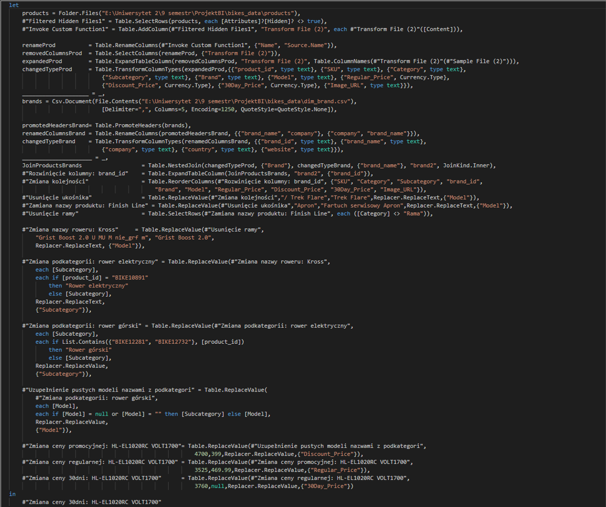

# Analiza sprzedarzy sklepu rowerowego

## Proces biznesowy – cel projektu
Celem projektu było dostarczenie potencjalnemu właścicielowi sieci sklepów rowerowych interaktywnego narzędzia **analitycznego (kokpitu BI)**, który umożliwia kompleksową **ocenę efektywności** sprzedaży detalicznej oraz internetowej na **przestrzeni ostatnich lat**.

Kluczowe aspekty analityczne:
- **Wykrywanie trendów i sezonowości**: identyfikacja okresów o podwyższonej sprzedaży w celu optymalizacji stanów magazynowych.
- **Analiza geograficzna**: wskazanie województw, powiatów o najlepszych wskaźnikach sprzedaży.
- **Optymalizacja asortymentu**: pozyskanie wiedzy o najchętniej kupowanych markach i produktach w danych regionach w celu lepszego dostosowania lokalnych ofert.
- **Charakterystyka koszyka**: analiza rozkładu produktów w zależności od kanału sprzedaży (online/stacjonarnie) oraz faktu zakupu roweru.

Główny nacisk położono na aspekt czasowy, umożliwiając analizę w ujęciu miesięcznym, kwartalnym i rocznym oraz swobodne przesuwanie analizowanego okna czasowego.

Kluczowe dla sukcesu było pozyskanie danych o:
- Rzeczywistym asortymencie sklepu rowerowego ([sprint-rower.pl](sprint-rower.pl)).
- Podziale administracyjnym województw i powiatów ([polskawliczbach.pl](polskawliczbach.pl)).
- Najpopularniejszych imionach i nazwiskach w Polsce ([dane.gov.pl/pl/dataset](dane.gov.pl/pl/dataset))

## Przygotowanie danych
Proces ten wymagał kilku etapów, aby od podstaw zbudować wiarygodne i spójne środowisko danych, które nie było dostępne w gotowych zbiorach:
- **Pozyskanie asortymentu:** wykorzystanie bibliotek Selenium i BeautifulSoup4 do ekstrakcji danych. Etap ten objął przejście przez 201 podstron z rowerami, oświetleniem, zapięciami, narzędziami, sakwami, kaskami i rękawiczkami. Pozwoliło to na uzyskanie rzeczywistej bazy produktów zawierających: kategorie, podkategorie, producenta, model, ceny oraz zdjęcia.
- **Uzyskanie danych geograficznych**: scraping danych o województwach, powiatach, w tym informacji o liczbie mieszkańców.
- **Budowa baza klientów**: wykorzystanie listy tysiąca najpopularniejszych imion i trzystu nazwisk (dla obu płci) oraz danych geograficznych do stworzenia unikalnej bazy 10 tys. odbiorców wraz z ich adresami dostawy.
- **Symulacja transakcji**: konstrukcja tabeli faktów na podstawie prawdopodobieństwa zakupowego (zależności pomiędzy płcią, kanałem sprzedaży a kategorią produktów; wpływ wielkości miasta na liczbę zamówień) oraz logiki sezonowej (szczyty sprzedaży w okresach letnich)

## Ekstrakcja, Transformacja, Ładowanie

    Proces ETL objął transformacją głównie:
    <ul>
        <li><b>Konsolidację</b>: połączenie miesięcznych zamówień w jedną tabele faktów oraz integracja bazy produktów.</li>
        <li><b>Standaryzację</b>: korekcję nazw kolumn, typów danych, usunięcie niektórych zmiennych, zmiany niektórych wartości (błąd cenowy lampki). Decyzja o połączeniu produktów i marki po id zamiast po nazwie marki (marka i firma czasami była tożsama).</li>
        <li><b>Rekonstrukcję Rekordów</b>: skorygowano błędy powstałe podczas scrapingu. W przypadkach algorytm niepoprawnie rozpoznał hierarchię (kategoria > podkategoria > model), więc zastosowano logikę warunkową w języku M, aby przywrócić spójność.</li>
        <li><b>Jakość kolumn</b>: wykryto, że kody SKU nie są unikalne, co doprowadziło do porzuceniu jego jako klucza głównego na rzecz wygenerowanego, unikalnego identyfikatora technicznego. Zapobiegło to relacji wiele-do-wielu.</li>
    </ul>

    

        
    

    

        
    

## Model danych
Schemat danych powstał już na etapie ich generowania, dzięki czemu połączenia relacjami w model gwiazdy było bezproblemowe.

Utworzono hierarchie dla następujących wymiarów:
- dim_brand:    firma > marka
- dim_address:  kraj > województwo > powiat
- dim_product:  kategoria > podkategoria > model
- dim_date:     rok > kwartał > miesiąc > dzień
(tabela obliczeniowa stworzona funkcją CALENDAR)

Klucze łączące tabele oraz pola tworzące hierarchie zostały ukryte, aby zapewnić przejrzystość i intuicyjność modelu.

