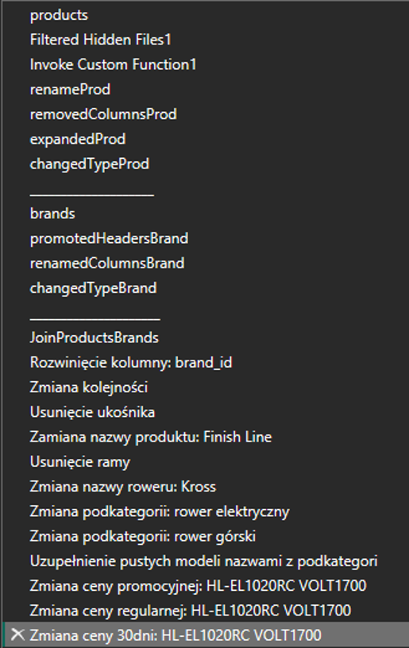
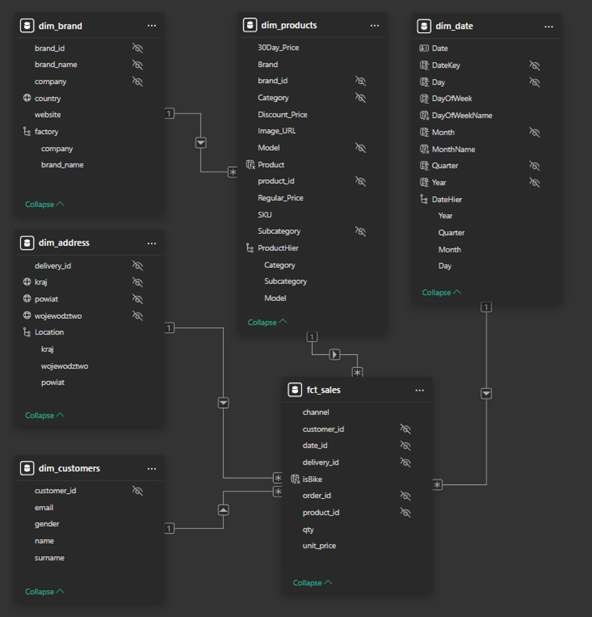
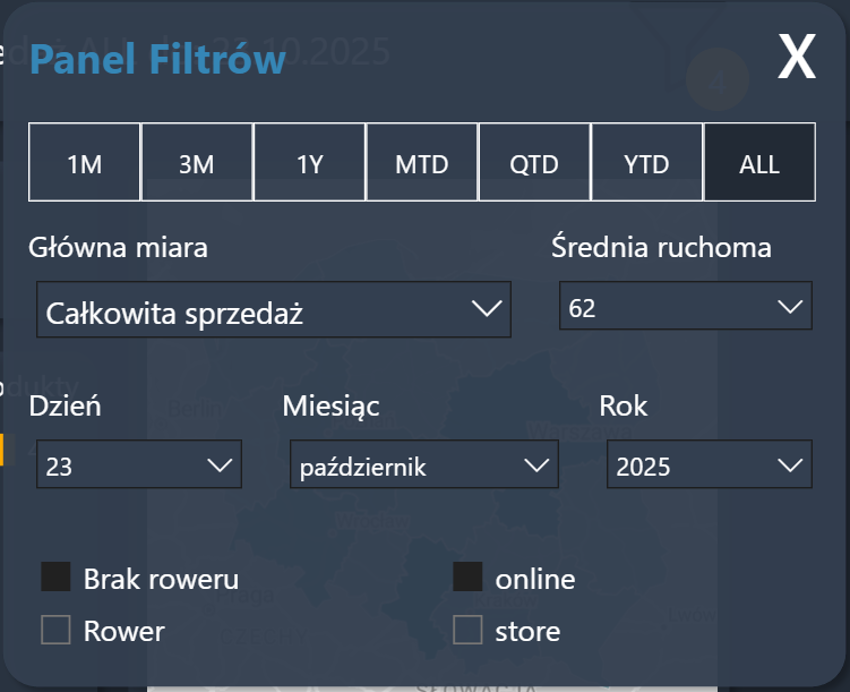
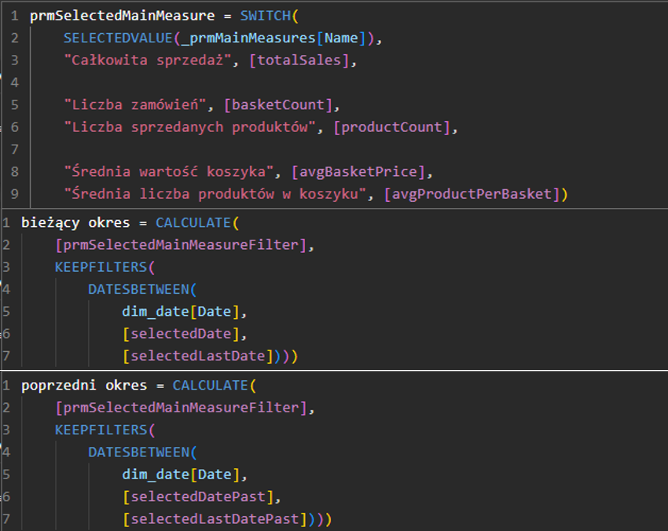
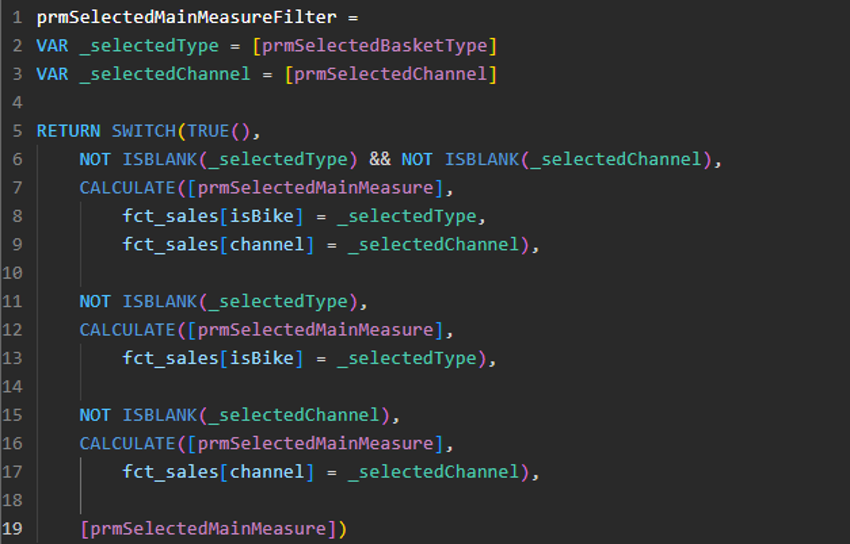
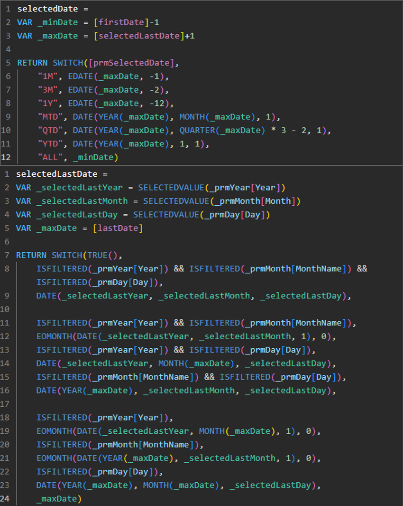
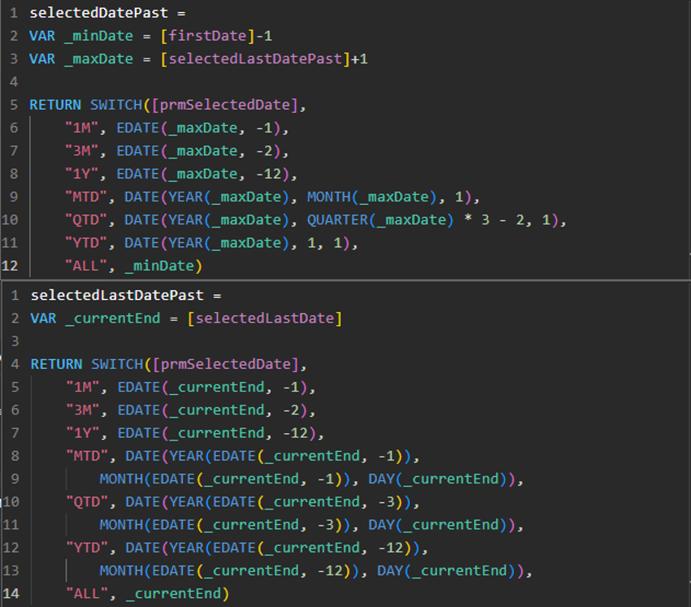
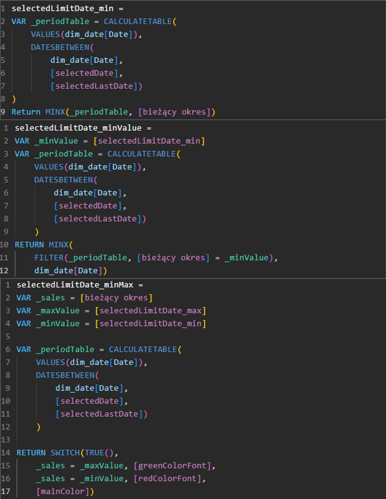
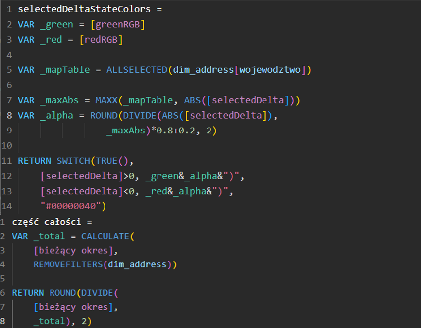

# Analiza sprzedarzy sklepu rowerowego

## Proces biznesowy – cel projektu
Celem projektu było dostarczenie potencjalnemu właścicielowi sieci sklepów rowerowych interaktywnego narzędzia **analitycznego (kokpitu BI)**, który umożliwia kompleksową **ocenę efektywności** sprzedaży detalicznej oraz internetowej na **przestrzeni ostatnich lat**.

Kluczowe aspekty analityczne:
- **Wykrywanie trendów i sezonowości**: identyfikacja okresów o podwyższonej sprzedaży w celu optymalizacji stanów magazynowych.
- **Analiza geograficzna**: wskazanie województw, powiatów o najlepszych wskaźnikach sprzedaży.
- **Optymalizacja asortymentu**: pozyskanie wiedzy o najchętniej kupowanych markach i produktach w danych regionach w celu lepszego dostosowania lokalnych ofert.
- **Charakterystyka koszyka**: analiza rozkładu produktów w zależności od kanału sprzedaży (online/stacjonarnie) oraz faktu zakupu roweru.

Główny nacisk położono na aspekt czasowy, umożliwiając analizę w ujęciu miesięcznym, kwartalnym i rocznym oraz swobodne przesuwanie analizowanego okna czasowego.

Kluczowe dla sukcesu było pozyskanie danych o:
- Rzeczywistym asortymencie sklepu rowerowego ([sprint-rower.pl](sprint-rower.pl)).
- Podziale administracyjnym województw i powiatów ([polskawliczbach.pl](polskawliczbach.pl)).
- Najpopularniejszych imionach i nazwiskach w Polsce ([dane.gov.pl/pl/dataset](dane.gov.pl/pl/dataset))

## Przygotowanie danych
Proces ten wymagał kilku etapów, aby od podstaw zbudować wiarygodne i spójne środowisko danych, które nie było dostępne w gotowych zbiorach:
- **Pozyskanie asortymentu:** wykorzystanie bibliotek Selenium i BeautifulSoup4 do ekstrakcji danych. Etap ten objął przejście przez 201 podstron z rowerami, oświetleniem, zapięciami, narzędziami, sakwami, kaskami i rękawiczkami. Pozwoliło to na uzyskanie rzeczywistej bazy produktów zawierających: kategorie, podkategorie, producenta, model, ceny oraz zdjęcia.
- **Uzyskanie danych geograficznych**: scraping danych o województwach, powiatach, w tym informacji o liczbie mieszkańców.
- **Budowa baza klientów**: wykorzystanie listy tysiąca najpopularniejszych imion i trzystu nazwisk (dla obu płci) oraz danych geograficznych do stworzenia unikalnej bazy 10 tys. odbiorców wraz z ich adresami dostawy.
- **Symulacja transakcji**: konstrukcja tabeli faktów na podstawie prawdopodobieństwa zakupowego (zależności pomiędzy płcią, kanałem sprzedaży a kategorią produktów; wpływ wielkości miasta na liczbę zamówień) oraz logiki sezonowej (szczyty sprzedaży w okresach letnich)

## Ekstrakcja, Transformacja, Ładowanie

    Proces ETL objął transformacją głównie:
    <ul>
        <li><b>Konsolidację</b>: połączenie miesięcznych zamówień w jedną tabele faktów oraz integracja bazy produktów.</li>
        <li><b>Standaryzację</b>: korekcję nazw kolumn, typów danych, usunięcie niektórych zmiennych, zmiany niektórych wartości (błąd cenowy lampki). Decyzja o połączeniu produktów i marki po id zamiast po nazwie marki (marka i firma czasami była tożsama).</li>
        <li><b>Rekonstrukcję Rekordów</b>: skorygowano błędy powstałe podczas scrapingu. W przypadkach algorytm niepoprawnie rozpoznał hierarchię (kategoria > podkategoria > model), więc zastosowano logikę warunkową w języku M, aby przywrócić spójność.</li>
        <li><b>Jakość kolumn</b>: wykryto, że kody SKU nie są unikalne, co doprowadziło do porzuceniu jego jako klucza głównego na rzecz wygenerowanego, unikalnego identyfikatora technicznego. Zapobiegło to relacji wiele-do-wielu.</li>
    </ul>

  
  

## Model danych
Schemat danych powstał już na etapie ich generowania, dzięki czemu połączenia relacjami w model gwiazdy było bezproblemowe.

Utworzono hierarchie dla następujących wymiarów:
- dim_brand:    firma > marka
- dim_address:  kraj > województwo > powiat
- dim_product:  kategoria > podkategoria > model
- dim_date:     rok > kwartał > miesiąc > dzień
(tabela obliczeniowa stworzona funkcją CALENDAR)

Klucze łączące tabele oraz pola tworzące hierarchie zostały ukryte, aby zapewnić przejrzystość i intuicyjność modelu.

## Dashboard – dynamiczny wybór
Zaprojektowany raport jest jednostronną aplikacją, która koncentruje się na elastyczność analizy i aspekcie czasowy. 

Fundamentem jest wielowarstwowy silnik obliczeniowy oparty na tabelach rozłącznych pełniących rolę parametrów, które są wybierane z poziomu ukrywanego panelu filtrów:
- **Dynamiczny wybór KPI**: system pozwala wybrać główną miarę, która staje się podstawą obliczeniową dla wszystkich wizualizacji na stronie spośród:
    - Całkowitej sprzedaży,
    - Liczby zamówień,
    - Liczby sprzedanych produktów,
    - Średniej liczby produktów w koszyku,
    - Średniej wartości koszyka.
    - Segmentacja koszyka: filtrowanie koszyków po obecności roweru oraz kanale sprzedaży, zaszyte w miarach.
- **Dwustopniowe Time Intelligence**: możliwość wybrania szerokości okna czasowego (1M, 3M, MTD, itd.), oraz precyzyjnego umiejscowienie go w czasie
- **Średnia krocząca**: wybór liczby jej dni.

  
  
  

  
  

## Dashboard – wizualizacja danych
Oprócz silnika obliczeniowego, raport wspiera użytkownika w identyfikacji zdarzeń dla zadanych filtrów:
- **Identyfikacja ekstremów**: system wyznacza minimalne oraz maksymalne wartości w wybranym oknie czasowym. Precyzyjnie wyznaczając datę ich wystąpienia oraz nanosi je na wykresie sprzedaży dziennej.
- **Dynamiczna geowizualizacja**: dla mapy (krajów, województw oraz powiatów) oblicza jest gradacja przeźroczystości (RGBA) poszczególnych obszarów. Dzięki czemu od razu widzimy, które regiony wypadają lepiej w porównaniu ze wcześniejszym okresem.
- **Kontekstowe etykiety (Tooltips)**: najechanie na dany region umożliwia wgląd w udział procentowy wybranego obszaru w sprzedaży.
- **Dynamiczne treści**: raport dostosowuje tytuły wizualizacji do wybranych parametrów oraz prezentuje dane o najlepiej sprzedającym się produkcie (wraz z jego nazwą i zdjęciem) dla aktualnie wybranych filtrów.

Całość została osadzona na tle SVG, co eliminuje opóźnienia w renderowaniu przy intensywnej interakcji z filtrami.

  
  

